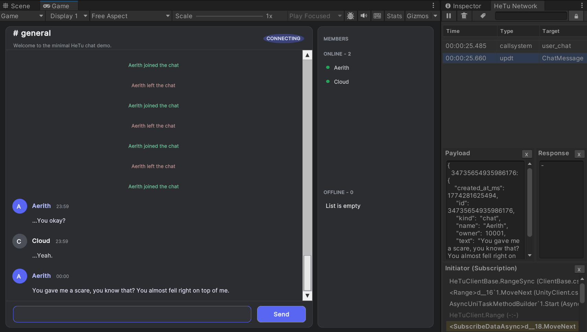
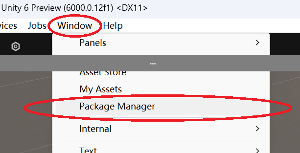
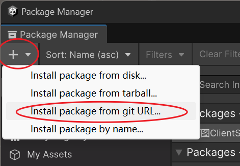

[](https://codecov.io/github/Heerozh/HeTu)
[](https://deepwiki.com/Heerozh/HeTu)

English | [简体中文](README.zh-CN.md)

> [!NOTE]
> In closed beta: currently being developed and used in-house.

# 🌌 HeTu (河图)

HeTu is an auto-scaling, high-performance game server engine. It follows the modern
"data-driven development" paradigm, but is built for high-frequency RPC and stateful
in-memory computation.

90% of the code is hand-written the old-fashioned way, and all of it is carefully
designed.

- High productivity: a transparent 2-tier model. Write your logic directly, without
  worrying about the database, transactions or thread conflicts.
- Python: use the whole AI and data-science ecosystem, and be ready for what comes next.
- High performance: a highly concurrent async architecture with a Redis backend.
  Database operations are roughly 10x faster than Supabase and similar platforms.
- Stateful: other platforms in this space focus only on data. HeTu focuses on stateful
  computation over long-lived connections.
- Unity client SDK: C# Reactive support and simple calls. It is reactive by nature
  because the server pushes changes, so views stay decoupled from business logic.

See [Benchmarks](#-benchmarks) below for performance numbers.

## Schema as API

HeTu exposes the database's read-only interface to game clients. Through the SDK,
clients can safely subscribe with get/range queries under RLS (row-level security).
Subscribed data syncs automatically. Database write callbacks drive the sync, so there
is no polling, and updates arrive in under 1 ms.

Only server-side logic can write data. Clients call it via RPC. It works like stored
procedures, but is much easier to write.

## Free and Open Source

Contributions are welcome. For commercial use, just credit HeTu in your Credits.

## 🔰 Quick Example



A simple chat room. Server code:

```Python
# Define a Component: like a database table, its attributes are the columns
@hetu.define_component(namespace="Chat", permission=hetu.Permission.EVERYBODY)
class ChatMessage(hetu.BaseComponent):
    owner: np.int64 = hetu.property_field(0, index=True)
    text: str = hetu.property_field("", dtype="U256")


# Define a System: clients call it via RPC; it can run game logic or write to the database
@hetu.define_system(
    namespace="Chat", components=(ChatMessage,), permission=hetu.Permission.USER
)
async def user_chat(ctx: hetu.SystemContext, text: str):
    assert ctx.caller, "call user_login first"
    row = ChatMessage.new_row()
    row.owner = ctx.caller
    row.text = text
    await ctx.repo[ChatMessage].insert(row)
```

Client code:

```csharp
// UI members: a send button and a chat list
private ListView _messageList;
private Button _composerSend;

// Send:
_composerSend.clicked += () => {  
    _ = HeTuClient.Instance.CallSystem("user_chat", text); 
}

// Chat list: subscribe to server pushes and update the UI automatically
_messageList.itemsSource = _messages;

// Latest 1024 messages (desc: a larger snowflake id is newer)
var messageSub = await HeTuClient.Instance.WatchRange<ChatMessage>(
    "id", 0, long.MaxValue, 1024, desc: true);
messageSub.AddTo(gameObject); // Bind to the lifetime: unsubscribes when the GameObject is destroyed
messageSub.ObserveAdd()  // Listen for new messages; the initial rows are emitted first (newest to oldest)
    .Subscribe(msg =>
    {
        // Insert by id so the list stays ordered from oldest to newest
        var i = _messages.FindIndex(m => m.ID > msg.ID);
        _messages.Insert(i < 0 ? _messages.Count : i, msg);
        _messageList.Rebuild();
        _messageList.ScrollToItem(_messages.Count - 1);
    })
    .AddTo(ref messageSub.DisposeBag);

```

See the full example: [examples/chat/server/src/app.py](examples/chat/server/src/app.py)

#### Start the server

See [Installation](#%EF%B8%8F-installation) for details:

```bash
cd examples/chat/server
# The demo uses an SQLite test database, so it starts as-is
uv run hetu start --config=./config.yml
```

## 📊 Benchmarks

### Setup:

|                  |                    Server type |                                          Settings |
|:-----------------|-------------------------------:|--------------------------------------------------:|
| HeTu             |               cs.c9ae.16xlarge |  32 cores / 64 threads, defaults, --workers=76 |
| Redis 7.0        | redis.shard.with.proxy.small.ce | Lowest tier, single AZ, 4 nodes, read/write split |
| Benchmark client |                          Local |      cli: uv run ya ya_hetu_rpc.py -n 1200 -t 1.1 |

### Results:

- hello world: serialize and return "hello world".
- get + update: one Component, read and write one random row, 30k-row table.
- get*2 + update*2: same as above, done twice.
- get: one Component, read one random row, 30k-row table.

CPS (calls per second):

| Time           | hello world(Calls) | get + update(Calls) | get*2 + update*2(Calls) | get(Calls) |
|:---------------|-------------------:|--------------------:|------------------------:|-----------:|
| Avg (per sec)  |          1,200,929 |              90,776 |                  54,260 |    422,817 |
| CPU load       |                98% |                 88% |                     78% |        98% |
| Redis load     |                 0% |                 97% |                     90% |        41% |

- _These tests use a single Component and are limited by the master's write I/O.
  Multiple Components (if loosely coupled) can scale out through Redis Cluster._

### Single-connection performance:

Run with `-n 1 -p 1`: single-threaded, synchronous and blocking, so it mainly measures RTT:

| Time          | hello world(Calls) | get + update(Calls) | get*2 + update*2(Calls) | get(Calls) |
|:--------------|-------------------:|--------------------:|------------------------:|-----------:|
| Avg (per sec) |             29,921 |               1,498 |                     827 |      5,704 |
| K90 RTT(ms)   |               0.03 |                0.69 |                    1.33 |       0.18 |

### About Python performance

Python's speed is not a problem. CPUs now cost far less than developers, and Python
does better on fast iteration, data analysis and the AI ecosystem.

The Python community is very active, almost like a human-powered JIT. With an async,
distributed architecture, throughput and RTT depend on the Redis backend, not on the
language.

### Native computation

Component data is already a NumPy C struct. So you can use cffi (an FFI modeled on
LuaJIT's) to call C/Rust code at very low cost:

```python
from cffi import FFI

ffi = FFI()
ffi.cdef("""
    void process(char* data, size_t n); // cast char* to Position* on the C side
""")
c_lib = ffi.dlopen("lib.so")

# Get an array of Position
pos_repo = ctx.repo[Position]
rows = await pos_repo.range("x", pos.x - 10, pos.x + 10)
c_lib.process(ffi.from_buffer("char[]", rows), len(rows))  # zero-copy, passes a pointer
for row in rows:
    await pos_repo.update(row)
```

Note that C code is not always faster than NumPy (NumPy uses SIMD), for example in a
batch computation like this:
`rows.x[rows.x >= 10] -= 10`

## ⚙️ Installation

For development, we recommend installing with the uv package manager. On Windows, run:

```bash
winget install --id=astral-sh.uv -e
```

Create your project directory and initialize uv in it (Python `3.14` or newer is required):

```shell
uv init --python "3.14"
```

uv now manages your project, much like npm. Add HeTu to your project's dependencies:

```shell
uv add hetudb
```

You also need a Redis deployment with persistence enabled. That is not covered here.

Start HeTu:

```bash
uv run hetu start --app-file=./app.py --db=redis://127.0.0.1:6379/0 --namespace=ssw --instance=server_name
```

See `hetu start --help` for other options. For example, you can start with
`hetu start --config ./config.yml`. The config template is in
hetu/CONFIG_TEMPLATE.yml.

## 🎉 Production Deployment

In production, we recommend deploying with Docker or installing directly with pip.

### Docker deployment

Install Docker first, then create a `Dockerfile` in your project directory:

```Dockerfile
FROM heerozh/hetu:latest

WORKDIR /app

COPY . .
RUN pip install .

ENTRYPOINT ["hetu", "start", "--config=./config.yml"]
```

The image is published on [Docker Hub](https://hub.docker.com/r/heerozh/hetu). In
mainland China, use `registry.cn-shanghai.aliyuncs.com/heerozh/hetu:latest` instead
(inside Aliyun's internal network, use
`registry-vpc.cn-shanghai.aliyuncs.com/heerozh/hetu:latest`).

#### Launch

Your project must use the src layout, or `RUN pip install .` will fail.

Then run:

```bash
# Build your app image
docker build -t app_image_name .
# Start your app
docker run -it --rm -p 2466:2466 --name server_name app_image_name
```

Docker lets you use HeTu's ability to start and stop instances freely. You can keep one
always-on server on a yearly plan and run everything else on discounted spot
(preemptible) instances. A reverse proxy then load-balances the connections.

### Native pip deployment

Containers usually cost about 20% in performance, so you may prefer a pip-based
deployment for always-on servers.

```bash
# Go to your project directory
cd your_app_directory

# Start HeTu. In production, use `python -O` to strip asserts for better performance
uv run python -O -m hetu start --config=./config.yml
```

uv installs the required Python version automatically. In mainland China, you can speed
up downloads with a PyPI mirror such as
`UV_INDEX_URL=https://mirrors.tuna.tsinghua.edu.cn/pypi/web/simple`.

### Redis deployment

Redis only needs persistence enabled. We recommend a master plus multiple read-only
replicas on separate machines. All data subscriptions can then be served by replicas,
which greatly reduces load on the master.

HeTu only uses basic Redis features, so it works with Redis forks such as Valkey and
Aliyun Tair. Redis Proxy and Redis Cluster are also supported.

### Load balancing

In production, put a reverse proxy in front of HeTu for load balancing.

Reverse proxy choices:

- Caddy: automatic HTTPS certificates and automatic reverse proxying
    - Run the caddy-docker-proxy Docker Swarm container on the load-balancer machine
    - Switch caddy-docker-proxy to controller mode so it reads the cluster's service labels
    - HeTu containers just need the labels. They are added to the proxy when they start
      and removed when they shut down.
    - Game clients need to reconnect automatically
    - If you don't want Swarm, you can control Caddy yourself through its admin API.
- Nginx: dated, with complex and ambiguous configuration. Not recommended.

## ⚙️ Client SDK Installation

### Unity SDK

The HeTu Unity SDK is built on async/await. It supports Unity 2022 and later on all
platforms, including WebGL. It depends on UnityWebSocket and UniTask, and the SDK's
installer can install them for you.

To import the client SDK in Unity, open "Window" -> "Package Manager" -> "+" ->
"Add package from git URL"




Then enter the package URL:
`https://github.com/Heerozh/HeTu.git?path=/ClientSDK/unity/cn.hetudb.clientsdk`

Then follow the setup wizard and install the dependencies it lists.

If your project already depends on UniTask, remove one of the two copies.

> [!NOTE]
> On Unity 6 and later, the SDK uses Unity's native async library and won't ask you to
> install UniTask.

### .NET SDK

There is no dedicated .NET SDK yet. The core of the Unity SDK does not depend on Unity,
so you can extract it.

## 📚 Documentation

See the [HeTu Documentation](https://hetudb.vercel.app/) for full documentation.

## 🗯 Discussion

Head over to [GitHub Discussions](https://github.com/Heerozh/HeTu/discussions).

## ⚖️ Code Style

Code is checked with basedPyright and PyCharm and formatted with Ruff.

Docstrings must be bilingual (Chinese and English).

# ©️ Copyright & Thanks

Copyright (C) 2023-2025, by Zhang Jianhao (heeroz@gmail.com), All rights reserved.
